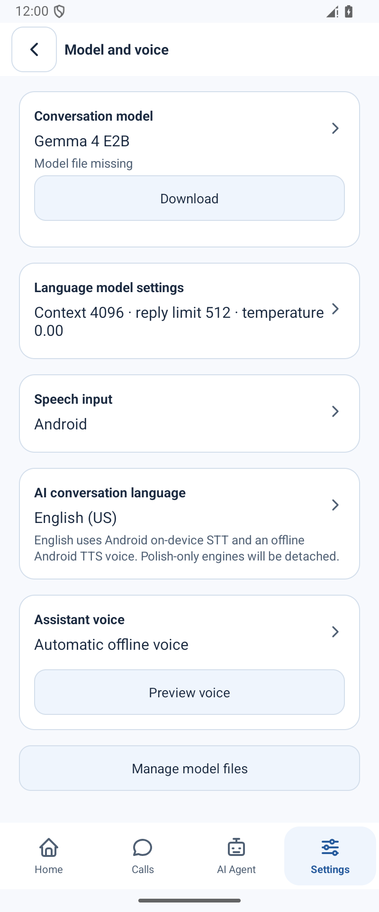

# AI Calls

An on-device assistant for authorized GSM calls on the Samsung Galaxy S22+ with Android 16. It handles incoming and outgoing calls in Polish and English, with local transcripts and notes.

[Download the S8 Lab test APK](https://github.com/MichalMatu/ai-calls/releases/download/s8lab-preview-ba2a4640/ai-calls-s8lab.apk).

## Install and set up

1. Open the downloaded APK on the phone and install it. In Android settings, set AI Calls as the default Phone app. Grant microphone and SIM access in **Settings → Permissions and default apps**.
2. While the phone is idle, open **Settings → GSM audio**. Follow **ADB pairing** to enable Wireless debugging and pair with a code, then tap **Start GSM audio host**.
3. Open **Model and voice**. Choose **Gemma 4 E2B** or **E4B**, download it and tap **Check compatibility**. Set **AI conversation language** and preview an offline voice. **App language** sets the menu language.
4. Choose the SIM and mode under **Answering calls**, or start a task from **New outgoing call**. Edit **Conversation instructions** or **AI Agent → Receptionist behavior**. Use the **Offline laboratory** for synthetic tests.

| Settings | Model and voice |
| --- | --- |
|  |  |
| Open GSM audio, permissions and app language. | Choose the model, conversation language and offline voice. |

[Developer documentation](docs/README.md).
