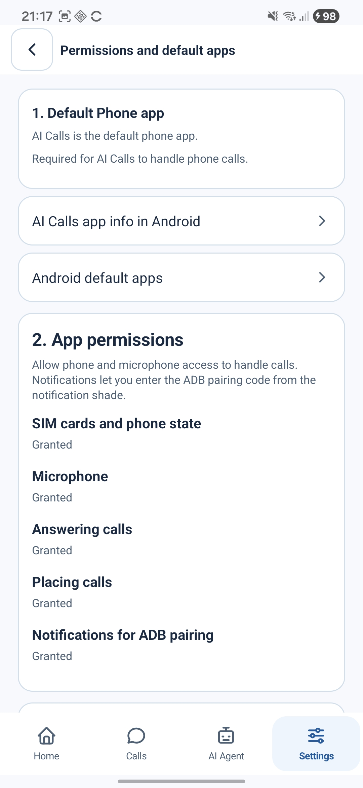
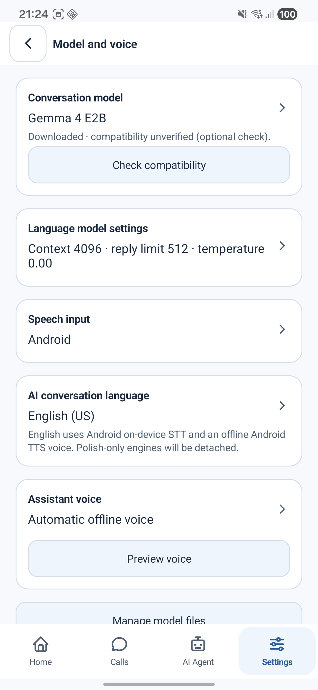
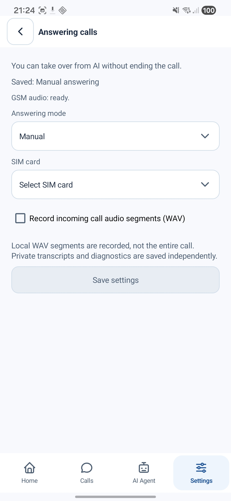

# AI Calls

**An on-device AI phone assistant for Android.** AI Calls can help answer incoming calls, prepare authorized outgoing call tasks, run local speech and language models, and keep a private record of conversations.

**MVP preview · Samsung Galaxy S22+ (SM-S906B) · Android 16**

The GSM setup below applies to **AI Calls 0.2.3**. The published 0.2.2 APK lacks Wireless ADB setup in the main AI Calls app. Check the release page for APKs and their SHA-256 checksums. [GitHub releases](https://github.com/MichalMatu/ai-calls/releases)

> **Preview, not a production-qualified dialer.** On-device GSM transport has only been developed for the specified S22+ / Android 16 configuration. Polish incoming GSM, encrypted notes and WAV have earlier physical evidence; live English GSM and outgoing flows still require acceptance on this build. Only use calls you own or are authorized to handle.

## What can it do?

- **Incoming calls:** choose AI or manual answering, assign a SIM and take over an active AI-managed call using STOP/takeover.
- **Outgoing tasks:** prepare a purpose, recipients, SIM and time window, then explicitly approve the call (experimental; no automatic dialing by installing the app).
- **Private conversation history:** locally saved history, encrypted notes and optional WAV recordings, with controls to disable recordings.
- **On-device AI:** downloaded Gemma models, configurable conversation instructions/skills, local speech recognition and voice output, language choices for Polish and English.
- **Settings and diagnostics:** model compatibility checks, microphone/phone permissions, GSM host readiness and an isolated laboratory for supported testing flows.

The Android interface currently uses Views; the code is split into UI, presentation/domain logic, data adapters and JVM modules. [Architecture](docs/architecture/SYSTEM.md) · [MVP status](docs/PROJECT.md)

## Install on Samsung S22+ (Android 16)

1. Open the **AI Calls APK** on the phone and follow the Android installer prompts.
2. Open **AI Calls → Settings → Permissions and default apps** (*Uprawnienia i aplikacje domyślne*). Under **1. Default Phone app**, tap **Set as phone app** (*Ustaw jako aplikację Telefon*) and confirm in Android. If Android denies the request, open **AI Calls app info in Android → ⋮ → Allow restricted settings** (*Zezwól na ograniczone ustawienia*). Confirm, return to AI Calls and retry. [Android Help](https://support.google.com/android/answer/12623953)
3. Under **2. App permissions**, check what Android granted with the Phone app role. If all rows say **Granted**, continue to **3. GSM audio**. Use **Grant access** for any missing permission. **SIM cards and phone state** lets AI Calls list your SIM cards. **Notifications for ADB pairing** lets you reply with the code from the notification shade.
4. Connect the phone to Wi-Fi. If **Developer options** are hidden, go to **Android Settings → About phone → Software information** and tap **Build number** seven times. Back in AI Calls, open **3. GSM audio**.

  
  
  

## Wireless ADB pairing — enter the code in the top notification shade

Pairing runs on the phone over Wi-Fi. Android displays a six-digit code. Enter it in the **AI Calls notification** while the Android code window stays open. The app discovers the local port automatically.

1. In **GSM audio / Audio GSM**, tap **Start pairing in Android / Rozpocznij parowanie w Androidzie**. Allow notifications if prompted. AI Calls opens Android Developer options and posts a pairing notification.
2. Open **Wireless debugging / Debugowanie bezprzewodowe**, enable it and tap **Pair device with pairing code / Sparuj urządzenie kodem parowania**. **Leave the Android popup with its six-digit code visible.**
3. **Swipe down from the very top of the screen** to open the notification shade (*górna szuflada powiadomień*). Expand **AI Calls — GSM pairing / parowanie GSM** if needed, tap **Enter code / Wpisz kod**, type the **six digits shown in the Android popup**, and submit the notification reply.
4. Wait for the **“Sparowano / Paired”** notification. Go back to AI Calls → **GSM audio**. While the phone is **not in a call**, tap **“Uruchom host audio GSM / Start GSM audio host”**.
5. Tap **Refresh status / Odśwież stan**. Expect **ADB: connected and authorized / połączono i autoryzowano** and **GSM audio: ready / Audio GSM: gotowe**.

  
  

  
  

If you do not see the reply notification, check **AI Calls notification permission** and that notifications are not blocked. You can alternatively use the six-digit field inside AI Calls in split-screen mode, keeping Android's code popup open. If pairing fails, reopen the Android pairing-code dialog to get a **new** code; do not reuse an expired code. After a reboot, you may need to re-enable Wireless debugging and **start the GSM host again**.

## Finish setup and use

1. Open **Model and voice / Model i głos** and download a supported Gemma model. Start with **Gemma 4 E2B**. Run **Check compatibility**, choose the conversation language, and tap **Preview voice**.
2. For incoming calls, return to **Permissions and default apps → 4. SIM and call answering / Karta SIM i odbieranie**. Select the **SIM**, choose **AI — answer and take messages**, and tap **Save settings**. Turn on **Record incoming call audio segments (WAV)** if you want local audio segments.

  
  

For outgoing calls, choose a SIM in the task and explicitly approve the call. Adjust **Conversation instructions** before using real conversations.

**Security:** Wireless ADB grants powerful local debugging access. Use only on your own phone, disable it when not needed, and never share pairing codes, tokens, call audio or private transcripts. The app uses a package-bound shell host and checks an exact device/UID, but this MVP is not a general security audit.

## Contributions welcome

Issues, reproducible bug reports, documentation improvements, tests, accessibility work and focused pull requests are welcome. For a larger change, open an issue first; preserve the existing UI, user data, exact Call/SIM ownership and STOP/takeover safety gates. Never include personal call data or secrets in PRs. See [developer documentation](docs/README.md).

**License:** No reuse/distribution license is declared in this repository at present; please discuss licensing with the maintainer before reusing the code outside this project.
