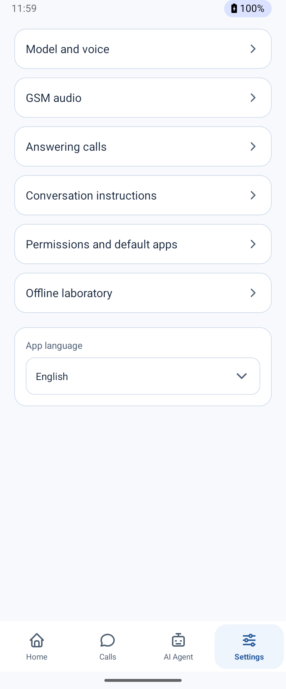

# AI Calls

An on-device assistant for authorized GSM calls on Samsung S22+ (Android 16), with PL/EN profiles, local transcripts, encrypted notes and WAV recordings.

[Download AI Calls 0.2.1](https://github.com/MichalMatu/ai-calls/releases/download/v0.2.1/ai-calls-v0.2.1.apk) · [SHA256](https://github.com/MichalMatu/ai-calls/releases/download/v0.2.1/SHA256SUMS.txt). Test preview, not production. PL incoming GSM, notes and WAV verified; EN synthetic speech passed, full EN GSM unverified.

## Install and set up

1. Open the downloaded APK on the phone and install it. In Android settings, set AI Calls as the default Phone app. Grant microphone and SIM access in **Settings → Permissions and default apps**.
2. While idle, open **Settings → GSM audio → Manage pairing**. Enable Wireless debugging, pair by code and reply to the AI Calls notification from the pull-down shade (or enter the code in the app). Tap **Start GSM audio host**.
3. Open **Model and voice**. Choose **Gemma 4 E2B** or **E4B**, download it and tap **Check compatibility**. Set **AI conversation language** and preview an offline voice. **App language** sets the menu language.
4. Choose the SIM and mode under **Answering calls**, or start a task from **New outgoing call**. Edit **Conversation instructions** or **AI Agent → Receptionist behavior**. Use the **Offline laboratory** for synthetic tests.

| Settings | Model and voice |
| --- | --- |
|  |  |
| Open GSM audio, permissions and app language. | Choose the model, conversation language and offline voice. |

[Developer documentation](docs/README.md).
