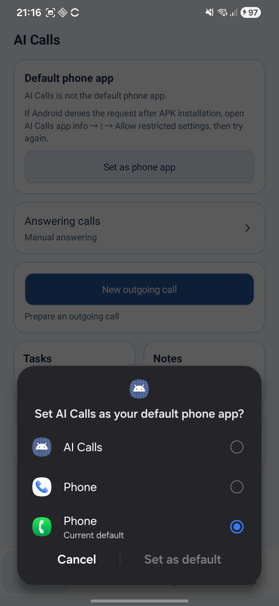
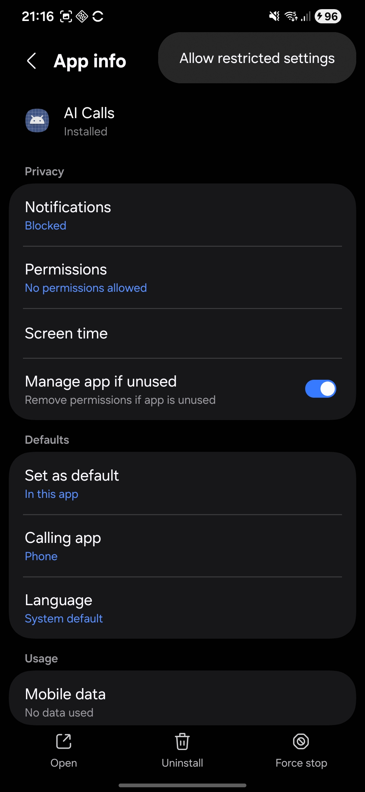
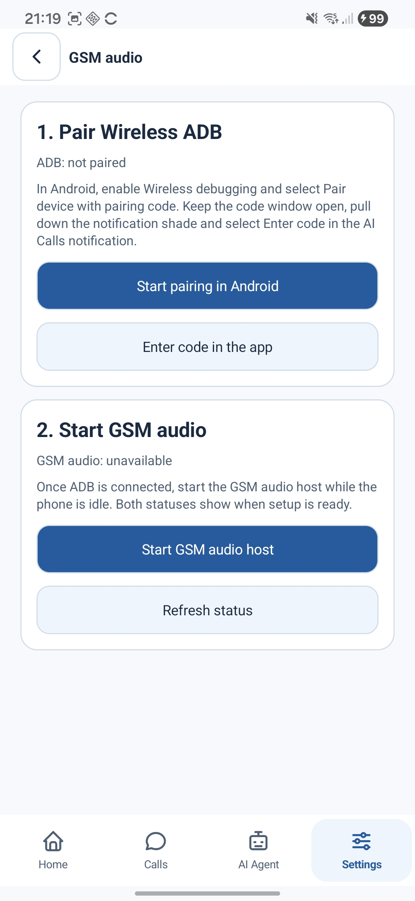
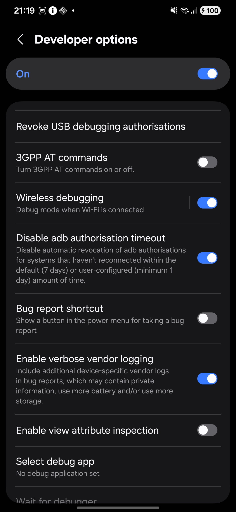
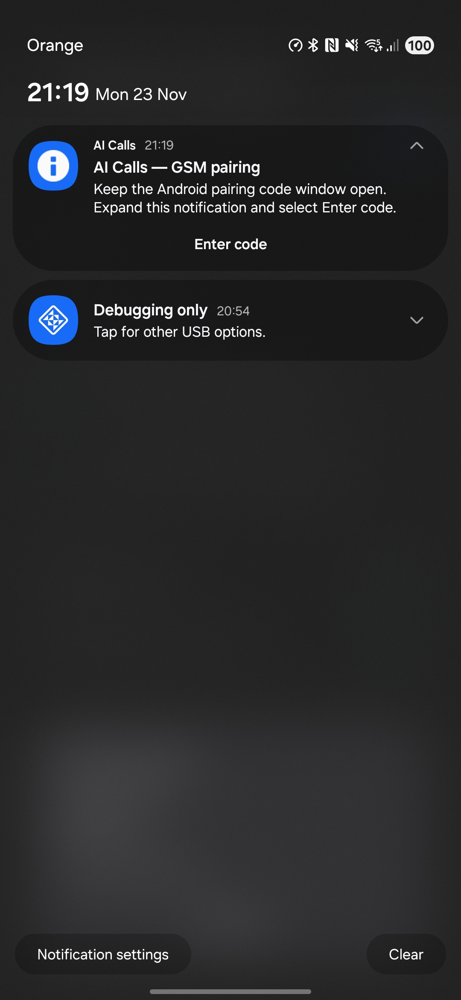
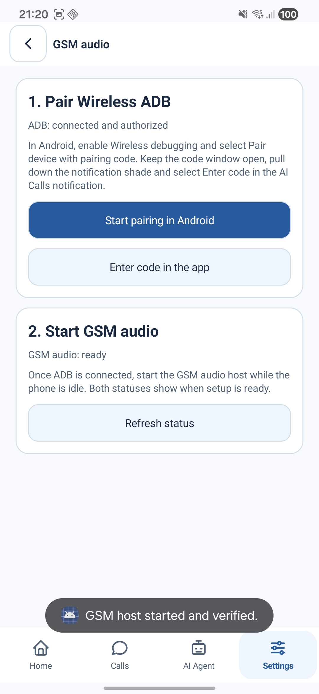
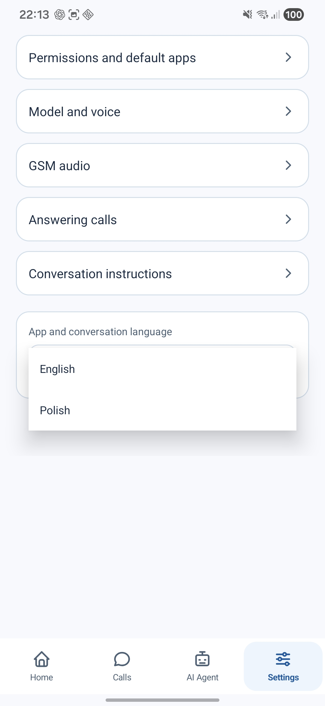

# AI Calls

**An on-device AI assistant for GSM calls.** AI Calls can answer on a selected SIM, take a message, and prepare outgoing enquiries for your approval. Gemma and the selected speech engines run on the phone.

**MVP preview · Samsung Galaxy S22+ (SM-S906B) · Android 16**

Use **AI Calls 0.2.3** for this guide. The latest published APK, **0.2.2**, lacks the Wireless ADB setup shown here. Release assets include the APK and its SHA-256 checksum. [GitHub releases](https://github.com/MichalMatu/ai-calls/releases)

The preview targets the S22+ configuration above. See the project status for the exact builds tested and the scope of each result. [Validation status](docs/PROJECT.md)

## What can it do?

- Switch between AI and manual answering. Use **STOP** to take over an active AI-managed call.
- Prepare an experimental outgoing enquiry by choosing the recipients, SIM and time window. Explicitly approve each task.
- Review local conversation history and encrypted notes. Enable local WAV segments separately if you want audio evidence.
- Choose a Gemma model, voice, speaking language and conversation instructions.

## Install on Samsung S22+ (Android 16)

1. Verify the APK against the release checksum. Open it in **My Files → Downloads** and follow the Android installer prompts.
2. Open **AI Calls → Settings → Permissions and default apps → 1. Default Phone app**. Tap **Set as phone app** and select **AI Calls** in Android. If Android denies the request, open **AI Calls app info in Android → ⋮ → Allow restricted settings**, confirm, and retry. [Android Help](https://support.google.com/android/answer/12623953)
3. Under **2. App permissions**, check what Android granted with the Phone app role. If all rows say **Granted**, continue to **3. GSM audio**. Use **Grant access** for any missing permission. **SIM cards and phone state** lets AI Calls list your SIM cards. **Notifications for ADB pairing** lets you reply with the code from the notification shade.
4. Connect the phone to Wi-Fi. If **Developer options** are hidden, go to **Android Settings → About phone → Software information** and tap **Build number** seven times. Back in AI Calls, open **3. GSM audio**.

  
  
  

## Pair Wireless ADB

Pairing runs on the phone over Wi-Fi. Enter Android's six-digit code in the **AI Calls notification** in the top notification shade.

1. In **GSM audio**, tap **Start pairing in Android**. Allow notifications if prompted. AI Calls opens **Developer options** and posts a pairing notification.
2. Open **Wireless debugging**, enable it and tap **Pair device with pairing code**. Leave the Android code window open.
3. **Swipe down from the top of the screen**. Expand **AI Calls — GSM pairing**, tap **Enter code**, type the six digits from Android and submit the reply.
4. When the notification says **Paired**, return to **GSM audio**. With the phone idle, tap **Start GSM audio host**.
5. Tap **Refresh status** and look for **ADB: connected and authorized** and **GSM audio: ready**.

  
  

  
  

## Finish setup and use

1. In **Model and voice**, download **Gemma 4 E2B**, run **Check compatibility**, and tap **Preview voice**. Gemma needs a model download on first setup.
2. In **Permissions and default apps → 4. SIM and call answering**, select the SIM, choose **AI — answer and take messages**, and tap **Save settings**. Enable **Record incoming call audio segments (WAV)** if you want local audio segments.
3. Place a first incoming test call with a consenting caller. Check the greeting, a short reply and **STOP** takeover. In a separate call, check that a clear goodbye plays to completion before disconnecting.

  
  

### English and Polish

English is the default. Choose **English** or **Polish** under **Settings → App and conversation language**. The in-app selection changes the interface, built-in instructions, speech recognition, and voice for new conversations. Both languages use the same Gemma model. Your own instructions and task text keep the words you entered. Review the approval if an outgoing task was saved in the other language.

### Restore service or switch to manual

- **Pairing reply missing or expired.** Check notification permission and start a new pairing attempt. **Enter code in the app** is available in split-screen mode with the Android code window open.
- **GSM audio unavailable after a reboot.** Enable Wireless debugging and start the host again with the phone idle. Refresh the status. Pair again if the authorization was removed.
- **Manual answering.** Save **Manual** under **4. SIM and call answering**. You can also restore your previous Phone app in **Android default apps**.

Wireless ADB grants local debugging access. Use it on your own phone and switch it off when finished. Keep pairing codes, credentials, audio, and private transcripts out of shared reports. [Security design](docs/architecture/SECURITY.md)

## Contributions welcome

Reproducible bug reports, documentation, tests, accessibility improvements and focused pull requests are welcome. Include the version, device and steps, with sanitized evidence. Open an issue first for larger changes. [Build and release guide](docs/operations/DEVELOPMENT.md) · [Architecture](docs/architecture/SYSTEM.md)

The source is public on GitHub. Contact the maintainer about reuse or redistribution of the project code while a project license is pending.
