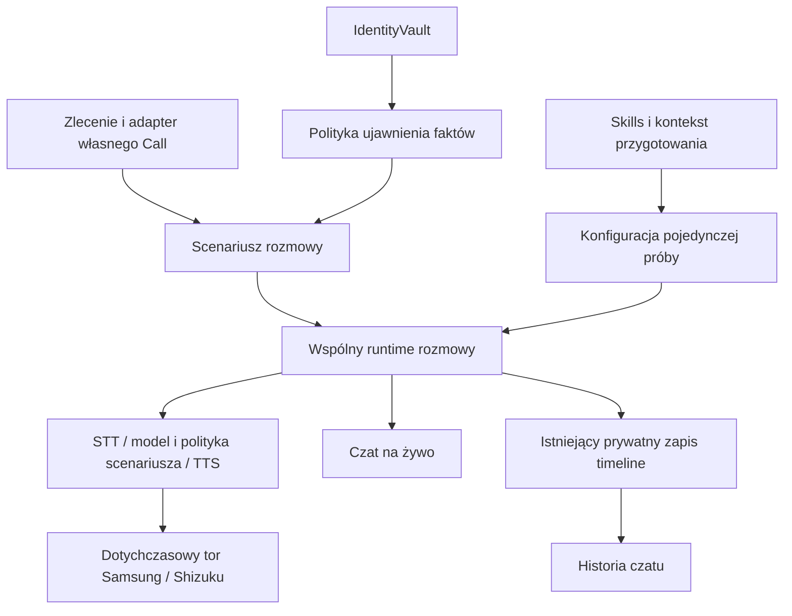

# Wspólny runtime rozmów — 2026-11-05

[Plan dalszego składania](PRODUCT_ASSEMBLY_PLAN.md) rozdziela profil użytkownika, konkretne zadanie, rozszerzalne skillsy/instrukcje i archiwum. Opisane poniżej moduły są obecnie granicami logicznymi w aplikacji; osobne biblioteki będą wydzielane przy pionowych integracjach. [Adapter odbierania](INCOMING_ASSISTANT.md) wdraża manual/AI/przejęcie ze wspólnym silnikiem i osobnym rdzeniem JVM conversation-core; fizyczna kwalifikacja pozostaje QA_PENDING.

## Opcjonalna polityka ciszy dla INCOMING — 2026-11-06

ConversationScenario udostępnia wyłącznie dla sekretarki przychodzącej politykę czasową 30 s aktywnego nasłuchu + ostrzeżenie + 15 s czasu na odpowiedź. IncomingIdleTimeout liczy tylko monotoniczny czas otwartego RX, nie model/TTS, i nie resetuje się przy bezmownym retry STT. Oba komunikaty przechodzą ten sam output approval i TTS/TX; dopiero po finalnym TX aplikacja proponuje end_call przez dotychczasowego wykonawcę w aktualnym Call/grancie. [Checkpoint](checkpoints/2026-11-06-incoming-idle30.md). Fizyczna cisza/hangup nadal QA_PENDING.

## Granice modułów

`conversation/AndroidConversationRuntime` jest jedynym wykonawcą potoku mowy i cyklu sesji. Przyjmuje `ConversationScenario`, nie tworzy zadania CLIR, celu Orange, danych abonenta ani zezwoleń skutków. Używa dotychczasowych adapterów STT/TTS i zamrożonego Samsung/Shizuku. Stary ChatRelayLiveCallProbe został przeniesiony, a wszyscy bieżący callerzy i audyty zmigrowani; brak drugiego runnera lub wrappera starego API. Nazwa prywatnego raportu/protokół diagnostyczny pozostają wspólne z istniejącymi narzędziami.

| Moduł | Odpowiedzialność |
|---|---|
| `ConversationScenario` / `ConversationDialogueSession` | Kierunek, profil przygotowania, backend, polityka zatwierdzania wypowiedzi, zdarzenia i wynik scenariusza |
| `campaign/ClirConversationScenario` | Obecne zadanie wychodzące: Orange/CLIR, rozpoznanie kontekstu usługi, typed effect, jeden CallCommitmentGate, autoryzowany fakt PHONE i prowizoryczne twierdzenie operatora |
| `SupervisedConversationScenario` | Diagnostyczne dołączenie do istniejącej rozmowy bez wybierania, rozłączania i skutków |
| `ConversationSessionRegistry` | Własność sesji; odrzucony drugi start nie konstruuje modelu ani nie czyści mailbox. Stary callback nie zwalnia nowego właściciela; release po teardown |
| `ConversationRunConfiguration` | Snapshot silników, strategii, instrukcji Direct i przygotowania rozmowy na jedną próbę |
| `ConversationPreparation` / `ConversationSkill` | Skills, informacje ogólne i referencje do wymaganych danych; profil wychodzący albo przychodzący |
| `ConversationInstructionBuilder` | Składanie instrukcji z właściwą rolą dzwoniącego lub odbierającego; brak odczytu wartości IdentityVault |
| `AndroidConversationPreparationStore` | Szyfrowane, atomowe rekordy w noBackupFilesDir, osobno od historii; jednorazowa migracja dawnych preferencji skills |
| `ConversationChatFeed` / `ConversationChatPanel` | Prywatny widok aktywnej rozmowy, neutralne role rozmówcy/modelu/skryptu i token chroniący przed spóźnionymi callbackami |
| `RecordedConversationHistory` / `ConversationHistoryActivity` | Czytnik istniejących prywatnych timeline; bez kopiowania transkryptów do drugiej bazy i bez limitu liczby sesji/wypowiedzi |

`ConversationOutcome.Completed` opisuje zakończenie scenariusza; nie zastępuje osobnego dowodu skutku zewnętrznego ani zakończenia workflow. Model nie otrzymuje interfejsu tworzenia tego wyniku lub upoważnienia.

## Przygotowanie i dane a uprawnienia

Przygotowanie rozmowy edytuje się w „Skills i dane rozmów” na ekranie głównym lub z narzędzi kampanii. Nie wymaga grantu ani aktywnego połączenia. Są oddzielne profile wychodzący i przychodzący: notes/kontekst ogólny, skills oraz identyfikatory pól sejfu. Zapisywanie profilu nie dzwoni, nie odbiera telefonu, nie zatwierdza skutku i nie nadaje prawa ujawnienia danych.

Wartości osobowe pozostają w istniejącym IdentityVault; kontekst przechowuje referencje `IdentityFieldId`. W scenariuszu CLIR dostępne pola są przecięciem wskazanych referencji i aktualnego zakresu zadania. Odznaczenie pola może zawęzić jego użycie; samo zaznaczenie nie rozszerza upoważnienia. RAW nadal nie ma brakującego interfejsu FactRequest (F-048); nie wprowadzono obejścia przez wklejenie wartości sejfu do promptu.

Skills są obecnie instrukcjami modelu. Nie stanowią mechanizmu wykonywania dowolnego kodu ani narzędzi; skryptowy scenariusz zachowuje swój klasyfikator i reguły. Wspólny snapshot niesie przygotowanie dla obu strategii, a Direct składa z niego instrukcję. Nowe scenariusze mogą korzystać z tych samych portów, zachowując aplikacyjną politykę efektów i ujawnień.

Odczyt konfiguracji jest lazy na ścieżce przygotowania. STOP nie wymaga otwarcia katalogu danych ani Keystore. Późniejsze edycje nie zmieniają kontekstu już przygotowanej próby.

## Przebieg rozmowy i historia

Widok live jest niezależny od danych przygotowania. Trwała historia korzysta z transkryptów zapisywanych już przez `CallSessionEvidenceRecorder`, zgodnie z istniejącym wyborem lokalnego zapisu RX/TX i transkrypcji. Brak nowego domyślnego utrwalania rozmów. Wyczyszczenie widoku live nie usuwa prywatnego archiwum.

**Nowe wymaganie właściciela, jeszcze do implementacji:** każda obsługiwana sesja ma mieć pełny transkrypt/audio i jeden odsłuch całości oraz fragmentów z czatu. Obecny RX zapisuje okna STT, TX zaakceptowane bajty AI/ACK; nie zapewnia to pełnego pokrycia ani głosu użytkownika po przejęciu. Pełny recorder ma być niezależny od VAD/dialogu i powiązany ze wspólnym czasem sesji. Luki pozostają jawne. Szczegóły, kolejność i kryteria w [planie produktu](PRODUCT_ASSEMBLY_PLAN.md); bieżący status F-080 w [BLOCKERS](../BLOCKERS.md).

Nowe sesje dostają metadane kierunku, identyfikatora profilu i rodzaju odpowiedzi. Starsze sesje bez metadanych są pokazywane z kierunkiem nieokreślonym, bez zgadywania. `AGENT_APPROVED_TEXT` jest tekstem zatwierdzonym do TTS, a status wysłania pochodzi z istniejącego `AGENT_FULL_TX`; brak TX po zakończeniu jest widoczny. Lokalny WRITE_COMPLETE nadal nie dowodzi słyszalności ani skutku u operatora.

Czytnik zgłasza liczbę uszkodzonych wpisów i zachowuje poprawne zdarzenia. Historia nie ma sztywnego limitu tur ani sesji. Pozostaje prywatnym widokiem istniejących plików, z dotychczasową rzeczywistą polityką przestrzeni dyskowej nagrań. Przygotowanie jest szyfrowane i wyłączone z backupu; ekrany kontekstu/historii mają FLAG_SECURE, bez eksportowanych aktywności lub wysyłania treści na zewnątrz.

## Rozmowy przychodzące — adapter i wspólny rdzeń

Model danych, instrukcje i archiwum obsługują INCOMING niezależnie od OUTGOING. Runtime nie wymaga nowego rozgałęzienia CLIR ani kopii silnika dla odbioru telefonu. AndroidIncomingAssistant dostarcza adapter konkretnego Call, przyjętą politykę odbierania i IncomingSecretaryScenario, a po rzeczywistym ACTIVE i MODE_IN_CALL podłącza go do tego samego runtime. Sterowanie odbiorem i generacjami jest w niezależnym JVM conversation-core.

Automatyczne odbieranie ma ustawienia AI/manual dla wybranego konta i przejęcie bez rozłączenia, bez aktywowania go samym profilem danych. Kod i granice dowodów opisuje [INCOMING_ASSISTANT](INCOMING_ASSISTANT.md). Test fizycznego przychodzącego ma QA_PENDING. Uprawnienia systemowe nadaje użytkownik. Przyjęcie przyszłego zadania/polityki nie może przerodzić się w ponowne pytanie o zgodę na każdą turę; scope, cofnięcie i STOP pozostają aplikacyjne.

## Wyniki

Baza `67c2382`. Nowy host green: pełna bramka `scripts/verify_host.sh`, audyty i oba APK. 785 JVM, 266 Python, 8 kontraktów S22 i 7 pełnych tur OUTGOING z kontrolowanym STOP PASS. Hashe i zakresy są zapisane w [checkpoint](checkpoints/2026-11-05-conversation-modules.md). Defekty i zakresy akceptacji wyłącznie w [BLOCKERS](../BLOCKERS.md), F-075–F-079 oraz wcześniejsze F-044/F-045/F-048/F-061. Nie utożsamiać testów struktury/przechowywania z gotowym automatycznym odbieraniem lub wykonaniem CLIR.
